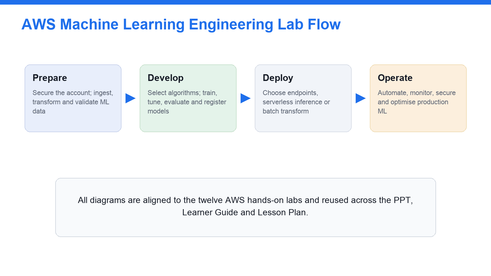
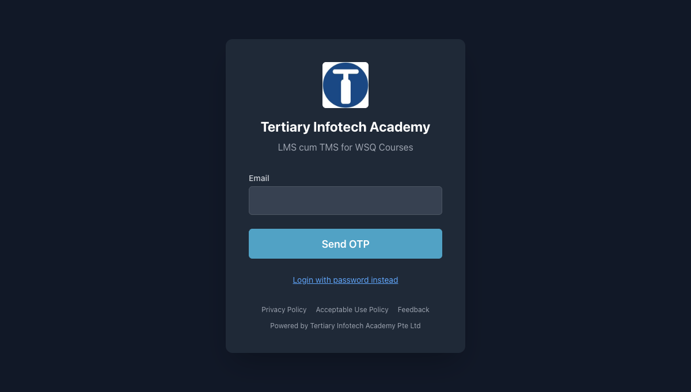
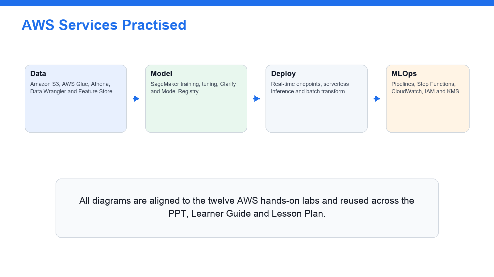
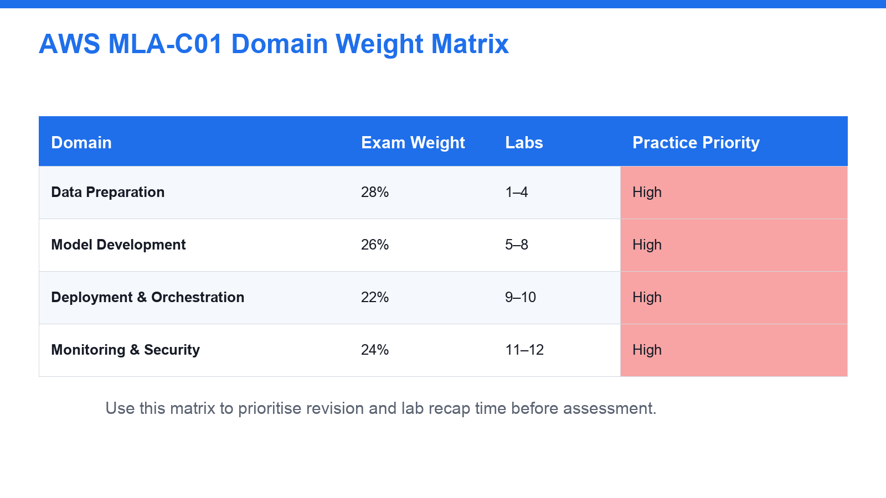
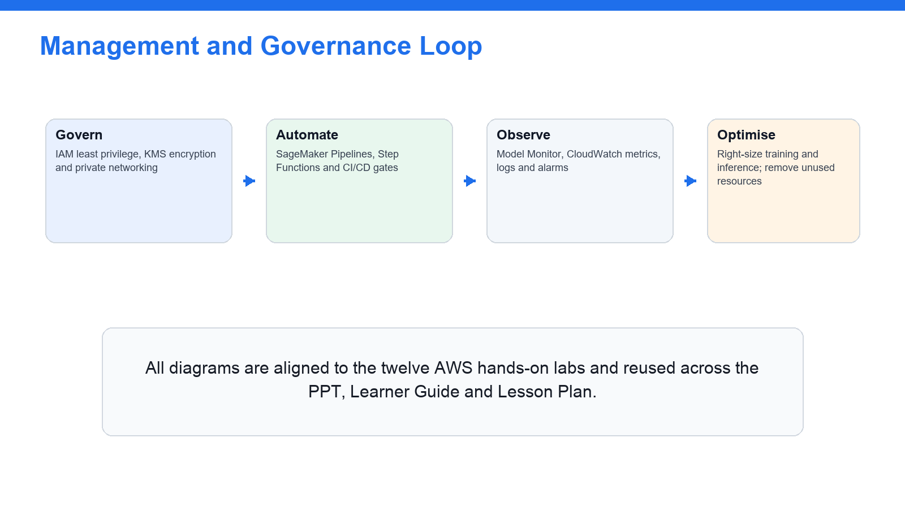
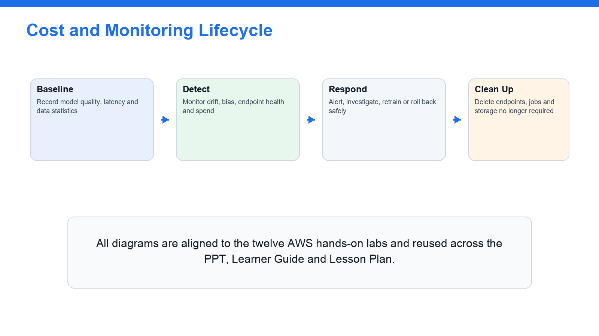
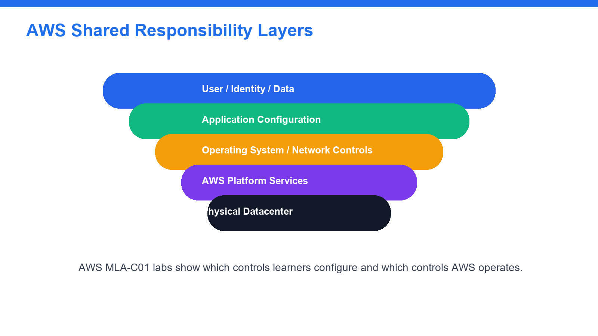
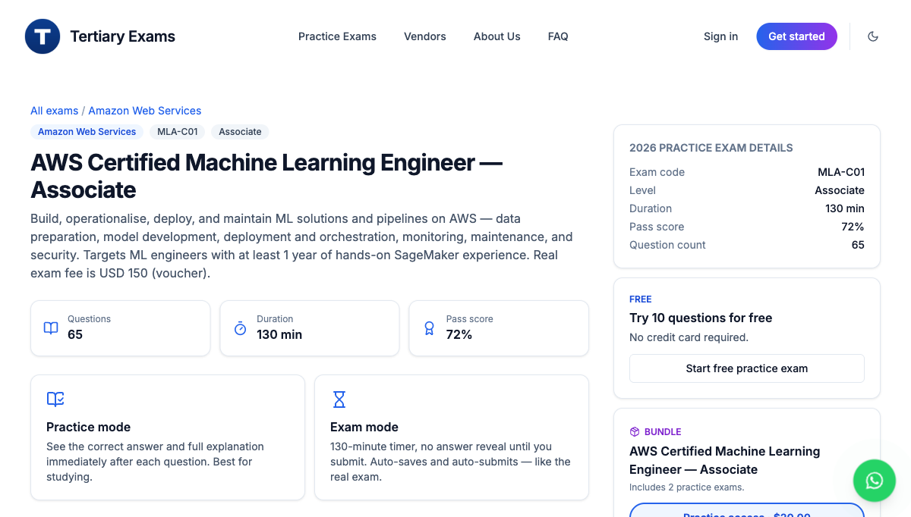

# AWS Certified Machine Learning Engineer Associate Training — Learner Guide

**WSQ Course Code:** TGS-2024049340  |  **Conducted by:** Tertiary Infotech Academy Pte Ltd (UEN 201200696W)  |  **Version v14 · 23 August 2026**

## Contents

- [Introduction](#introduction)
- [Course Learning Outcomes](#course-learning-outcomes)
- [Before You Start — Environment Setup](#before-you-start--environment-setup)
- [Domain 01 — Data Preparation for Machine Learning  (28%)](#domain-01--data-preparation-for-machine-learning--28)
  - [Lab 1 — Account Safety and IAM Baseline](#lab-1--account-safety-and-iam-baseline)
  - [Lab 2 — S3 ML Data Lake and Data Formats](#lab-2--s3-ml-data-lake-and-data-formats)
  - [Lab 3 — Batch and Streaming Ingestion with Glue, Athena and Kinesis](#lab-3--batch-and-streaming-ingestion-with-glue-athena-and-kinesis)
  - [Lab 4 — Feature Engineering, Feature Store, Labelling and Data Quality](#lab-4--feature-engineering-feature-store-labelling-and-data-quality)
- [Domain 02 — ML Model Development  (26%)](#domain-02--ml-model-development--26)
  - [Lab 5 — Modelling Approach, Algorithms and Managed AI Services](#lab-5--modelling-approach-algorithms-and-managed-ai-services)
  - [Lab 6 — SageMaker Training Jobs and Debugger](#lab-6--sagemaker-training-jobs-and-debugger)
  - [Lab 7 — Automatic Model Tuning, Experiments and Model Registry](#lab-7--automatic-model-tuning-experiments-and-model-registry)
  - [Lab 8 — Model Evaluation, Metrics, Bias and Explainability](#lab-8--model-evaluation-metrics-bias-and-explainability)
- [Domain 03 — Deployment and Orchestration of ML Workflows  (22%)](#domain-03--deployment-and-orchestration-of-ml-workflows--22)
  - [Lab 9 — Deployment Options, Endpoints, Batch Transform and Auto Scaling](#lab-9--deployment-options-endpoints-batch-transform-and-auto-scaling)
  - [Lab 10 — MLOps Pipelines, CI/CD, Orchestration and IaC](#lab-10--mlops-pipelines-cicd-orchestration-and-iac)
- [Domain 04 — ML Solution Monitoring, Maintenance and Security  (24%)](#domain-04--ml-solution-monitoring-maintenance-and-security--24)
  - [Lab 11 — Model Monitoring, Drift and Observability](#lab-11--model-monitoring-drift-and-observability)
  - [Lab 12 — Security, Governance, Cost Optimisation and Exam Review](#lab-12--security-governance-cost-optimisation-and-exam-review)
- [Exam Focus — Cross-Cutting Knowledge for MLA-C01](#exam-focus--cross-cutting-knowledge-for-mla-c01)
- [Exam Focus — Additional AWS Services & Decision Patterns (MLA-C01)](#exam-focus--additional-aws-services--decision-patterns-mla-c01)
  - [Domain 01 — Data Preparation for Machine Learning](#domain-01--data-preparation-for-machine-learning)
  - [Domain 02 — ML Model Development](#domain-02--ml-model-development)
  - [Domain 03 — Deployment and Orchestration of ML Workflows](#domain-03--deployment-and-orchestration-of-ml-workflows)
  - [Domain 04 — ML Solution Monitoring, Maintenance and Security](#domain-04--ml-solution-monitoring-maintenance-and-security)
  - [Scenario Exam-Decision Patterns](#scenario-exam-decision-patterns)
- [Exam Preparation](#exam-preparation)
- [Glossary](#glossary)


## Introduction

This Learner Guide accompanies the WSQ course AWS Certified Machine Learning Engineer Associate Training (TGS-2024049340), conducted by Tertiary Infotech Academy Pte Ltd. It provides step-by-step instructions for all twelve hands-on labs delivered over three training days and organised by the four official AWS Certified Machine Learning Engineer - Associate (MLA-C01) exam domains. Every lab maps to a published exam domain and is completed on AWS using the Management Console, AWS CloudShell/CLI and Amazon SageMaker AI.

Use this guide alongside the course slides and the lab files in the labs/ folder of the course repository. Work in trainer-provided AWS accounts where available. When you use your own account, enable MFA and set a budget alert before starting, use small datasets and short training jobs, and delete paid resources (endpoints, training jobs, pipelines, temporary buckets) when a lab tells you to.


## Course Learning Outcomes

- LO1: Prepare, ingest (batch and streaming), transform, engineer features for, label and govern data for machine learning on AWS using Amazon S3, AWS Glue, Athena, Kinesis, SageMaker Data Wrangler, Feature Store, Ground Truth and Clarify.
- LO2: Select a modelling approach and train, debug, tune, evaluate and register models with Amazon SageMaker AI, SageMaker JumpStart, Amazon Bedrock and AWS AI services.
- LO3: Deploy real-time, serverless, asynchronous and batch inference and orchestrate MLOps pipelines with SageMaker Pipelines, Step Functions, CodePipeline, EventBridge and Infrastructure as Code.
- LO4: Monitor, secure and cost-optimise ML solutions with SageMaker Model Monitor, CloudWatch, IAM, KMS, VPC and AWS cost tooling, and prepare for the AWS MLA-C01 certification exam.


## Before You Start — Environment Setup



*The twelve hands-on labs follow the ML lifecycle: Prepare → Develop → Deploy → Operate.*



*Download the slides, Learner Guide and Lesson Plan from lms-tms.tertiaryinfotech.com before class.*

**What you need**

- An AWS account — a trainer-provided sandbox account where available, otherwise your own account with MFA enabled and a budget alert configured before you begin.
- The AWS Management Console, plus AWS CloudShell (or the AWS CLI) for the command-line steps in each lab.
- Access to Amazon SageMaker AI (SageMaker Studio), Amazon S3, AWS Glue, Amazon Athena and the other services listed per lab.
- A working folder named TGS-2024049340-AWS-MLA-Labs for your screenshots, notebooks, SQL snippets, model metrics and comparison tables.

**Set a safe baseline**

Confirm your identity and Region, enable MFA where permitted, and create a budget alert so a runaway training job or endpoint cannot generate a surprise bill. Verify the AWS CLI works in CloudShell before you start Lab 1.

```bash
aws sts get-caller-identity        # confirm account and identity
aws configure list                  # confirm Region
aws budgets describe-budgets --account-id <ACCOUNT_ID>   # confirm a budget alert exists
```

**Cost-safety rules (apply to every lab)**

- Use small sample datasets and short training jobs; avoid GPU instances unless explicitly assigned.
- Stop SageMaker Studio apps and notebook instances when not in use.
- Delete real-time endpoints, training jobs, model packages and pipelines after the lab if instructed.
- Prefer serverless inference and batch transform over always-on endpoints for practice.
- Check Billing and Cost Management after each hands-on lab; keep budget alerts active until clean-up is confirmed.

**Conventions used in every lab**

- Console steps describe what to open and click; command steps give an AWS CLI command you can run in CloudShell.
- Placeholders such as <id>, <ACCOUNT_ID>, <arn> and <TARGET> are replaced with your own values.
- Each lab saves its evidence (screenshots, tables, checklists) into the TGS-2024049340-AWS-MLA-Labs folder.
- Run the clean-up step at the end of any lab that creates paid resources.


## Domain 01 — Data Preparation for Machine Learning  (28%)

Ingestion & storage · transformation & feature engineering · data quality, labelling & bias



*AWS data, model, deployment and MLOps services used across the labs.*

**Key concepts**

- Data formats — CSV, JSON, Parquet, ORC, Avro and RecordIO — column vs row storage, and which format suits analytics, streaming and SageMaker training.
- S3 ML data lake — Bucket + prefix design (raw/prepared/features/training/models/monitoring), default encryption (SSE-S3 / SSE-KMS) and Block Public Access.
- Batch & streaming ingestion — AWS Glue crawlers/jobs and the Data Catalog, Athena, and the Kinesis family (Data Streams, Firehose, MSK) for batch and streaming preparation.
- Feature engineering — Imputation, normalisation/standardisation, binning, one-hot encoding and scaling; online vs offline SageMaker Feature Store.
- Labelling — SageMaker Ground Truth labelling jobs for text, image and tabular data; human-in-the-loop and automated labelling.
- Data quality & bias — Glue Data Quality and SageMaker Clarify checks for nulls, duplicates, schema drift, outliers, class imbalance and data leakage.


### Lab 1 — Account Safety and IAM Baseline

Exam mapping: this lab develops your ability to secure an AWS ML workspace with identity, least-privilege IAM and cost guardrails (Domain 1: establish a safe ML foundation).

Goal: Set up a safe AWS baseline for ML engineering: confirm identity and Region, review IAM users, roles, groups and least privilege, understand the SageMaker execution role, enable MFA and a budget alert, and review KMS key concepts before any data lands.

**What you'll build**

A secured AWS ML workspace: verified identity/Region, a least-privilege IAM review, an enabled budget alert and notes on execution roles and KMS.   (Services: IAM, AWS KMS, AWS Budgets, Amazon SageMaker AI, AWS CloudShell, AWS CloudTrail.)

**Workflow at a glance**

Sign in & verify identity/Region → Review IAM roles & least privilege → Review the SageMaker execution role → Enable MFA & a budget alert → Review KMS key concepts.

**Step-by-step**

1. Sign in to the assigned AWS account and confirm your identity and Region before creating anything.

   ```bash
   aws sts get-caller-identity
   ```

2. Confirm the Region you are working in so every resource is created consistently.

   ```bash
   aws configure list
   ```

3. Review IAM users, groups, roles and attached policies in the account.

   ```bash
   aws iam list-roles --query 'Roles[?contains(RoleName,`SageMaker`)].RoleName'
   ```

4. Review least-privilege access for S3, SageMaker, Glue, Athena, KMS and CloudWatch, and note where each is over- or under-scoped.
5. Review the SageMaker execution-role concept: the role SageMaker assumes to read data from S3 and write model artifacts.

   ```bash
   aws iam get-role --role-name <SageMakerExecutionRole> --query 'Role.AssumeRolePolicyDocument'
   ```

6. Confirm MFA is enabled where permitted for human sign-in.

   ```bash
   aws iam list-mfa-devices
   ```

7. Create (or confirm) a monthly budget alert so a runaway training job or endpoint cannot cause a surprise bill.

   ```bash
   aws budgets describe-budgets --account-id <ACCOUNT_ID>
   ```

8. Review AWS KMS customer-managed-key concepts and how KMS keys protect S3 and SageMaker artifacts.

   ```bash
   aws kms list-keys --query 'Keys[0]'
   ```

9. Review CloudTrail to confirm that ML API calls are being audited in the account.

   ```bash
   aws cloudtrail describe-trails --query 'trailList[0].Name'
   ```

10. Save your identity, Region, IAM least-privilege, execution-role, MFA, budget and KMS notes as lab evidence.

**Test it — acceptance criteria**

You can verify your identity and Region, explain least-privilege IAM and the SageMaker execution role, and confirm MFA, a budget alert and KMS are in place before any ML data lands.

**Troubleshooting**

- Access denied calling an ML API — Attach a least-privilege policy for that action to your role/user.
- SageMaker cannot read S3 — Fix the SageMaker execution role's S3 permissions and trust policy.
- Surprise charges appear — Enable AWS Budgets alerts and delete idle resources immediately.

> **Note:** The self-contained lab file labs/lab-01-*.md carries the same steps with commands, evidence checklist, troubleshooting and acceptance criteria. Only run these steps in an AWS account you are authorised to use, and clean up paid resources afterwards.

---


### Lab 2 — S3 ML Data Lake and Data Formats

Exam mapping: this lab develops your ability to structure and secure an S3 data lake for ML and choose the right data format (Domain 1: data ingestion and storage).

Goal: Build the storage foundation for ML: create an encrypted S3 data lake with raw, prepared, features, training, models and monitoring prefixes, apply Block Public Access, lifecycle rules and storage classes, and compare the data formats used across ML workflows.

**What you'll build**

A secure, encrypted S3 ML data lake with six lifecycle prefixes and a data-format comparison table.   (Services: Amazon S3, AWS KMS, S3 Lifecycle, Amazon SageMaker AI.)

**Workflow at a glance**

Create an encrypted S3 bucket → Enable Block Public Access → Add ML lifecycle prefixes → Set storage-class lifecycle rules → Compare data formats.

**Step-by-step**

1. Create the ML data-lake bucket (only if your trainer permits), using a globally unique name.

   ```bash
   aws s3 mb s3://tgs-mla-<your-initials>-datalake --region ap-southeast-1
   ```

2. Enable default encryption on the bucket (SSE-S3 or SSE-KMS) so all objects are encrypted at rest.

   ```bash
   aws s3api put-bucket-encryption --bucket tgs-mla-<id>-datalake --server-side-encryption-configuration '{"Rules":[{"ApplyServerSideEncryptionByDefault":{"SSEAlgorithm":"aws:kms"}}]}'
   ```

3. Keep Block Public Access enabled on the bucket to prevent accidental exposure of training data.

   ```bash
   aws s3api put-public-access-block --bucket tgs-mla-<id>-datalake --public-access-block-configuration BlockPublicAcls=true,IgnorePublicAcls=true,BlockPublicPolicy=true,RestrictPublicBuckets=true
   ```

4. Create the ML lifecycle prefixes so raw, prepared, feature, training, model and monitoring data are separated.

   ```bash
   for p in raw prepared features training models monitoring; do aws s3api put-object --bucket tgs-mla-<id>-datalake --key $p/; done
   ```

5. Upload small sample CSV and JSON files to raw/ (if permitted) and review object metadata and storage class.

   ```bash
   aws s3 cp sample.csv s3://tgs-mla-<id>-datalake/raw/
   ```

6. Review S3 storage classes and add a lifecycle rule that transitions old raw data to Standard-IA then Glacier.

   ```bash
   aws s3api put-bucket-lifecycle-configuration --bucket tgs-mla-<id>-datalake --lifecycle-configuration file://lifecycle.json
   ```

7. Build a comparison table of CSV, JSON, Parquet, ORC, Avro and RecordIO and note the best format for analytics, streaming and training.
8. Note why columnar formats (Parquet/ORC) suit analytics and large-scale training while RecordIO-protobuf suits several built-in algorithms.
9. Confirm the bucket enforces encryption and blocks public access, and record the KMS key that protects it.

   ```bash
   aws s3api get-bucket-encryption --bucket tgs-mla-<id>-datalake
   ```

10. Save your S3 structure, encryption, lifecycle and data-format notes as lab evidence.

**Test it — acceptance criteria**

You can navigate the encrypted S3 data lake with its six prefixes, explain storage-class lifecycle, and justify a data-format choice for analytics, streaming and SageMaker training.

**Troubleshooting**

- Bucket name already exists — S3 names are globally unique — add your initials/date.
- Access denied on PutObject — Attach a least-privilege S3 policy to your role/execution role.
- Objects not encrypted — Set default bucket encryption; existing objects must be re-copied.

> **Note:** The self-contained lab file labs/lab-02-*.md carries the same steps with commands, evidence checklist, troubleshooting and acceptance criteria. Only run these steps in an AWS account you are authorised to use, and clean up paid resources afterwards.

---


### Lab 3 — Batch and Streaming Ingestion with Glue, Athena and Kinesis

Exam mapping: this lab develops your ability to design batch and streaming ingestion into the ML data lake and query it in place (Domain 1: ingest and catalog data).

Goal: Land data into the lake two ways: crawl and catalog batch data with AWS Glue and query it with Athena, and design a near-real-time streaming path with the Kinesis family (Data Streams, Firehose, MSK) into S3, then compare batch and streaming trade-offs.

**What you'll build**

A cataloged batch dataset queryable in Athena plus a streaming-ingestion design and a batch-vs-streaming comparison.   (Services: AWS Glue, Glue Data Catalog, Amazon Athena, Kinesis Data Streams, Kinesis Data Firehose, Amazon MSK, Amazon S3.)

**Workflow at a glance**

Crawl raw/ with Glue → Catalog the schema → Query in Athena → Design a Kinesis streaming path → Compare batch vs streaming.

**Step-by-step**

1. Open AWS Glue and review crawlers, jobs, the Data Catalog and Glue Data Quality.

   ```bash
   aws glue get-databases --query 'DatabaseList[].Name'
   ```

2. Run a Glue crawler over the raw/ prefix to infer schema and populate the Data Catalog.

   ```bash
   aws glue start-crawler --name tgs-mla-raw-crawler
   ```

3. Confirm the cataloged table and its columns before querying.

   ```bash
   aws glue get-tables --database-name tgs_mla_db --query 'TableList[].Name'
   ```

4. Query the cataloged raw data with Athena to confirm the schema and profile the data.

   ```bash
   aws athena start-query-execution --query-string 'SELECT * FROM raw_customers LIMIT 10' --result-configuration OutputLocation=s3://tgs-mla-<id>-datalake/athena/
   ```

5. Review a Glue ETL job pattern that converts raw CSV/JSON to columnar Parquet in prepared/.
6. Review the Kinesis family — Data Streams, Data Firehose and Amazon MSK — and where each fits.

   ```bash
   aws kinesis list-streams
   ```

7. Design a streaming path: producers → Kinesis Data Streams or Firehose → S3 raw/ → Glue crawler → Catalog.

   ```bash
   aws firehose list-delivery-streams
   ```

8. Note how Managed Service for Apache Flink can compute streaming features in flight.
9. Build a batch-vs-streaming comparison across latency, services, typical use and where data lands.
10. Save the cataloged schema, an Athena query result, the streaming design and the comparison as lab evidence.

**Test it — acceptance criteria**

You can catalog and query batch data with Glue and Athena, design a Kinesis streaming path into the lake, and justify batch vs streaming from latency and use-case requirements.

**Troubleshooting**

- Crawler finds no tables — Point the crawler at the correct S3 prefix and re-run it.
- Athena query fails — Set an S3 query-result location and confirm the Glue table exists.
- Streaming data not landing in S3 — Check the Firehose delivery stream's IAM role and S3 destination.

> **Note:** The self-contained lab file labs/lab-03-*.md carries the same steps with commands, evidence checklist, troubleshooting and acceptance criteria. Only run these steps in an AWS account you are authorised to use, and clean up paid resources afterwards.

---


### Lab 4 — Feature Engineering, Feature Store, Labelling and Data Quality

Exam mapping: this lab develops your ability to engineer, store, label and validate features for machine learning (Domain 1: transform, engineer and validate data).

Goal: Turn cataloged data into trustworthy features: apply feature-engineering transforms in Data Wrangler, store reusable features in SageMaker Feature Store, review Ground Truth labelling, and validate quality and bias with Glue Data Quality and SageMaker Clarify.

**What you'll build**

A feature-engineering flow, an online/offline Feature Store design, and feature-engineering, data-quality and bias checklists.   (Services: SageMaker Data Wrangler, Feature Store, Ground Truth, Clarify, AWS Glue, Glue Data Quality, Amazon Athena.)

**Workflow at a glance**

Engineer features (Data Wrangler) → Store features (Feature Store) → Label data (Ground Truth) → Check quality (Glue DQ) → Check bias (Clarify).

**Step-by-step**

1. Open SageMaker Data Wrangler (or review its docs) and list transforms: missing-value imputation, normalisation, standardisation, binning and one-hot encoding.
2. Apply a feature-engineering flow to a sample customer-churn dataset and export the prepared features back to S3.
3. Review SageMaker Feature Store and record online vs offline feature-store use cases and feature groups.

   ```bash
   aws sagemaker list-feature-groups
   ```

4. Create (or design) a feature group for the churn features so training and serving read the same definition.

   ```bash
   aws sagemaker describe-feature-group --feature-group-name tgs-mla-churn-features
   ```

5. Review SageMaker Ground Truth labelling jobs for text, image and tabular data, and human-in-the-loop review.

   ```bash
   aws sagemaker list-labeling-jobs
   ```

6. Run (or review) Glue Data Quality rules for nulls, ranges, uniqueness and freshness on the prepared data.
7. Review SageMaker Clarify concepts for pre-training data-bias detection (class imbalance and skew).
8. Create a feature-engineering checklist (imputation, scaling, encoding, leakage avoidance) for the churn dataset.
9. Create a data-quality checklist covering nulls, duplicates, schema mismatch, outliers, class imbalance and data leakage.
10. Save the feature flow, the Feature Store design and all three checklists as lab evidence.

**Test it — acceptance criteria**

You can engineer features, store them for reuse in Feature Store, describe Ground Truth labelling, and validate a dataset for quality and bias with Glue Data Quality and Clarify.

**Troubleshooting**

- Features differ between train and serve — Use Feature Store so both read the same definition.
- Skewed classes bias the model — Detect with Clarify; rebalance or reweight before training.
- Data-quality rules keep failing — Fix the source or the transform; re-run Glue Data Quality.

> **Note:** The self-contained lab file labs/lab-04-*.md carries the same steps with commands, evidence checklist, troubleshooting and acceptance criteria. Only run these steps in an AWS account you are authorised to use, and clean up paid resources afterwards.

---


## Domain 02 — ML Model Development  (26%)

Modelling approach · training & debugging · tuning, experiments & Model Registry · evaluation, metrics & bias



*The four MLA-C01 exam domains and their weightings.*

**Key concepts**

- Problem framing — Classification, regression, clustering, forecasting, anomaly detection, NLP and computer vision — matching the problem to an approach.
- Approach selection — SageMaker built-in algorithms vs script-mode custom frameworks vs JumpStart vs Amazon Bedrock foundation models vs managed AI services.
- Training & debugging — Training jobs: input channels, instance type, container image, execution role; SageMaker Debugger and Profiler to catch training problems early.
- Tuning & experiments — Automatic Model Tuning (random, grid, Bayesian, Hyperband); SageMaker Experiments for reproducible trial tracking.
- Model Registry — Model package groups, versions, approval status and metadata for a repeatable train-to-approval workflow.
- Evaluation & bias — Confusion matrix, accuracy, precision, recall, F1, ROC AUC; MAE/MSE/RMSE/R2; Clarify bias metrics, SHAP and feature importance.


### Lab 5 — Modelling Approach, Algorithms and Managed AI Services

Exam mapping: this lab develops your ability to choose an AWS modelling approach based on data, outcome, cost and operations (Domain 2: select a modelling approach).

Goal: Decide how to solve an ML problem before training: match problem types to approaches and compare SageMaker built-in algorithms, script-mode custom frameworks, JumpStart, Amazon Bedrock foundation models and managed AI services, then build a model/service selection matrix.

**What you'll build**

A model/service selection matrix for five business scenarios with cost and interpretability notes.   (Services: Amazon SageMaker AI, SageMaker JumpStart, Amazon Bedrock, Rekognition, Comprehend, Textract, Translate, Transcribe.)

**Workflow at a glance**

List the ML problem types → Map each to an algorithm/service → Compare built-in vs script vs BYOC → Review JumpStart & Bedrock → Score with a selection matrix.

**Step-by-step**

1. List the common ML problem types: classification, regression, clustering, forecasting, anomaly detection, NLP and computer vision.
2. Review SageMaker built-in algorithm categories and when each is a good fit.
3. Review script mode for custom frameworks such as TensorFlow, PyTorch and scikit-learn, and Bring Your Own Container.
4. Open SageMaker JumpStart and browse prebuilt models and solution templates you can deploy or fine-tune.

   ```bash
   aws sagemaker list-models --max-results 5
   ```

5. Open Amazon Bedrock and review foundation-model use cases (text generation, summarisation, RAG) if available.

   ```bash
   aws bedrock list-foundation-models --query 'modelSummaries[0:5].modelId'
   ```

6. Review managed AI services: Rekognition, Comprehend, Textract, Translate and Transcribe, and their standard tasks.
7. Build a model/service selection table for five business scenarios, capturing data type, expected output, candidate service, interpretability need, cost and operational complexity.
8. Identify when a managed AI service is better than training a custom model.
9. Identify when a SageMaker training job is the more appropriate choice.
10. Save the selection matrix and the cost/interpretability notes as lab evidence.

**Test it — acceptance criteria**

You can choose an AWS modelling approach for a given business outcome and justify it against data, cost, interpretability and operational requirements.

**Troubleshooting**

- Unsure which algorithm fits — Match the problem type first (class/reg/cluster/forecast), then data size.
- AI service accuracy too low for the domain — Fine-tune (JumpStart/Bedrock) or train a custom model.
- Options hard to compare — Add cost, interpretability and ops columns to the selection matrix.

> **Note:** The self-contained lab file labs/lab-05-*.md carries the same steps with commands, evidence checklist, troubleshooting and acceptance criteria. Only run these steps in an AWS account you are authorised to use, and clean up paid resources afterwards.

---


### Lab 6 — SageMaker Training Jobs and Debugger

Exam mapping: this lab develops your ability to configure, run and debug a SageMaker training job efficiently (Domain 2: train models).

Goal: Run the training step end to end: configure input channels, instance, container and execution role, understand the training knobs and regularisation, choose input modes and cost options, and use SageMaker Debugger and Profiler to catch training problems early.

**What you'll build**

A configured, running training job plus Debugger/Profiler findings and a training-configuration checklist.   (Services: SageMaker Training, SageMaker Debugger, SageMaker Profiler, Amazon S3, Managed Spot training.)

**Workflow at a glance**

Configure the training job → Choose input mode & instance → Launch a script-mode job → Watch Debugger rules → Review Profiler & cost.

**Step-by-step**

1. Open SageMaker Training and review input channels, output path, instance type, container image and execution role.

   ```bash
   aws sagemaker list-training-jobs --max-results 5
   ```

2. Record the meaning of epoch, batch size, learning rate, steps and early stopping.
3. Compare input modes — File, Pipe and FastFile — and when each reduces start time or disk use.
4. Launch a small sample training job (script mode) and watch its status to completion.

   ```bash
   aws sagemaker describe-training-job --training-job-name tgs-mla-demo-train --query 'TrainingJobStatus'
   ```

5. Review regularisation techniques — L1, L2, dropout, pruning and feature selection — and how they curb overfitting.
6. Enable SageMaker Debugger built-in rules (vanishing gradients, overfitting, loss-not-decreasing) on the job.

   ```bash
   aws sagemaker describe-training-job --training-job-name tgs-mla-demo-train --query 'DebugRuleEvaluationStatuses'
   ```

7. Review the SageMaker Profiler report to spot GPU/CPU under-utilisation and I/O bottlenecks.
8. Review Managed Spot training and checkpointing to cut training cost on interruptible jobs.
9. Create a training-configuration checklist (channels, instance, container, role, hyperparameters, monitoring).
10. Save the training-job configuration, Debugger/Profiler findings and the checklist as lab evidence.

**Test it — acceptance criteria**

You can configure and launch a SageMaker training job, apply regularisation and cost options, and use Debugger and the Profiler to diagnose training problems.

**Troubleshooting**

- Training job fails to start — Check the execution role, input channels and instance limits.
- Validation loss diverges — Lower the learning rate; add regularisation and early stopping.
- Job is slow / GPU under-used — Use the Profiler to find I/O or utilisation bottlenecks.

> **Note:** The self-contained lab file labs/lab-06-*.md carries the same steps with commands, evidence checklist, troubleshooting and acceptance criteria. Only run these steps in an AWS account you are authorised to use, and clean up paid resources afterwards.

---


### Lab 7 — Automatic Model Tuning, Experiments and Model Registry

Exam mapping: this lab develops your ability to run repeatable tuning, track experiments and version-control models (Domain 2: tune and manage models).

Goal: Make model development repeatable: design an Automatic Model Tuning plan and compare search strategies, track trials with SageMaker Experiments, and version models through the Model Registry with an approval workflow.

**What you'll build**

A tuning plan, an experiment-tracking scheme and a model-versioning workflow from training job to approved model package.   (Services: SageMaker Automatic Model Tuning, SageMaker Experiments, SageMaker Model Registry, Amazon S3.)

**Workflow at a glance**

Define the objective metric → Choose a search strategy → Tune with AMT → Track trials in Experiments → Register & approve the model.

**Step-by-step**

1. Open Automatic Model Tuning and compare random search, grid search, Bayesian optimisation and Hyperband.
2. Create a tuning plan for a sample classification model: objective metric, hyperparameters, ranges, stopping condition and cost limit.

   ```bash
   aws sagemaker create-hyper-parameter-tuning-job --cli-input-json file://tuning.json
   ```

3. Launch (or review) a small tuning job and watch the best training job emerge.

   ```bash
   aws sagemaker describe-hyper-parameter-tuning-job --hyper-parameter-tuning-job-name tgs-mla-tune --query 'BestTrainingJob.TrainingJobName'
   ```

4. Open SageMaker Experiments and record how trials, parameters and metrics are tracked for reproducibility.

   ```bash
   aws sagemaker list-experiments --max-results 5
   ```

5. Compare candidate trials by the objective metric and select the best model.
6. Open the Model Registry and create a model package group for the model.

   ```bash
   aws sagemaker create-model-package-group --model-package-group-name tgs-mla-churn
   ```

7. Register a trained model version with metrics and metadata in the group.

   ```bash
   aws sagemaker list-model-packages --model-package-group-name tgs-mla-churn
   ```

8. Set the model version's approval status to gate promotion to deployment.

   ```bash
   aws sagemaker update-model-package --model-package-arn <arn> --model-approval-status Approved
   ```

9. Design the model-versioning workflow from training to tuning to registered, approved package.
10. Save the tuning plan, the experiment-tracking scheme and the versioning workflow as lab evidence.

**Test it — acceptance criteria**

You can define a tuning plan, track trials in Experiments, and register and approve a model version in the Model Registry as a repeatable workflow.

**Troubleshooting**

- Tuning is too expensive — Cap max/parallel jobs and narrow the hyperparameter ranges.
- Best trial is hard to find — Track runs in SageMaker Experiments and sort by the objective metric.
- Wrong model reaches deploy — Gate promotion with a Model Registry approval status.

> **Note:** The self-contained lab file labs/lab-07-*.md carries the same steps with commands, evidence checklist, troubleshooting and acceptance criteria. Only run these steps in an AWS account you are authorised to use, and clean up paid resources afterwards.

---


### Lab 8 — Model Evaluation, Metrics, Bias and Explainability

Exam mapping: this lab develops your ability to choose metrics, interpret results and check bias and explainability before approval (Domain 2: evaluate model performance).

Goal: Decide whether a model is fit to promote: compare classification and regression metrics, diagnose overfitting/underfitting and leakage, review Clarify bias and SHAP explainability, and write an evaluation and acceptance checklist.

**What you'll build**

An evaluation plan and model-acceptance checklist with metric thresholds and bias/explainability checks.   (Services: SageMaker Clarify, SageMaker training/evaluation, Amazon S3, Model Cards.)

**Workflow at a glance**

Split train/validation/test → Compute metrics (confusion matrix) → Diagnose over/underfitting → Check bias & SHAP (Clarify) → Set acceptance thresholds.

**Step-by-step**

1. Build a table of classification metrics: accuracy, precision, recall, F1 score, ROC AUC and the confusion matrix.
2. Add regression metrics: MAE, MSE, RMSE and R-squared, and note when each is preferred.
3. Review what overfitting and underfitting look like across training and validation metrics.
4. Review class imbalance and data-leakage examples and how they distort metrics.
5. Open SageMaker Clarify (or its docs) and record pre- and post-training bias metrics.

   ```bash
   aws sagemaker list-processing-jobs --name-contains clarify --max-results 5
   ```

6. Review feature-importance and SHAP-value concepts for model explainability, and Model Cards for documentation.
7. Design an evaluation plan for a binary classification model with a train/validation/test split strategy.
8. Define minimum acceptable metrics and the approval criteria for promoting the model.
9. Define the bias, fairness and explainability checks that must pass before approval.
10. Save the evaluation plan and acceptance checklist as lab evidence.

**Test it — acceptance criteria**

You can select appropriate metrics, interpret evaluation results, check bias and explainability, and decide whether a model is ready for approval or needs more data preparation or tuning.

**Troubleshooting**

- High accuracy but poor real performance — Data is likely imbalanced or leaking — use F1 and recheck features.
- Metrics differ sharply train vs test — Overfitting — regularise, add data or simplify the model.
- Model unfair across groups — Use Clarify bias metrics and mitigate before approval.

> **Note:** The self-contained lab file labs/lab-08-*.md carries the same steps with commands, evidence checklist, troubleshooting and acceptance criteria. Only run these steps in an AWS account you are authorised to use, and clean up paid resources afterwards.

---


## Domain 03 — Deployment and Orchestration of ML Workflows  (22%)

Inference infrastructure · endpoints & auto scaling · MLOps pipelines, CI/CD & IaC



*Govern, secure and audit ML workloads through the pipeline.*

**Key concepts**

- Inference options — Real-time endpoints, serverless inference, asynchronous inference and batch transform — latency, payload, traffic and cost trade-offs.
- Endpoint operations — Endpoint config, multi-model/multi-container endpoints, auto scaling on invocations-per-instance, blue/green and rollback.
- Orchestration — SageMaker Pipelines steps (processing, training, tuning, condition, register, callback), Step Functions and EventBridge triggers.
- CI/CD — CodePipeline and CodeBuild for automated build/test/deploy; model approval gates and artifact storage.
- Infrastructure as Code — CloudFormation, CDK and SageMaker project templates to make ML infrastructure repeatable.
- Safe delivery — Validation, approval, failure paths, retries and rollback so models move from development to production safely.


### Lab 9 — Deployment Options, Endpoints, Batch Transform and Auto Scaling

Exam mapping: this lab develops your ability to select and operate SageMaker inference infrastructure for a workload (Domain 3: deploy models).

Goal: Choose the right inference pattern: compare real-time endpoints, serverless inference, asynchronous inference and batch transform, understand endpoint configuration, auto scaling and safe delivery, and select infrastructure for several workloads.

**What you'll build**

An inference-option comparison table with use-case deployment choices and an auto-scaling and rollback checklist.   (Services: SageMaker Inference, real-time & serverless endpoints, Batch Transform, Application Auto Scaling, CloudWatch.)

**Workflow at a glance**

Pick the inference pattern → Create the endpoint config → Deploy the model → Register auto scaling → Verify metrics, then clean up.

**Step-by-step**

1. Open SageMaker Inference and review model artifact, container image, endpoint configuration and endpoint concepts.

   ```bash
   aws sagemaker list-endpoints --max-results 5
   ```

2. Review real-time endpoints (low, steady latency), serverless inference (spiky traffic) and asynchronous inference (large payloads).
3. Review batch transform for offline scoring of a whole dataset.

   ```bash
   aws sagemaker create-transform-job --cli-input-json file://batch-transform.json
   ```

4. Create an endpoint config and deploy a model to a real-time endpoint (sample model).

   ```bash
   aws sagemaker create-endpoint --endpoint-name tgs-mla-rt --endpoint-config-name tgs-mla-cfg
   ```

5. Register auto scaling on the endpoint using invocations-per-instance as the target metric.

   ```bash
   aws application-autoscaling register-scalable-target --service-namespace sagemaker --resource-id endpoint/tgs-mla-rt/variant/AllTraffic --scalable-dimension sagemaker:variant:DesiredInstanceCount --min-capacity 1 --max-capacity 4
   ```

6. Review blue/green, canary and shadow deployment and how deployment guardrails auto-roll-back on alarms.
7. Build an inference-option comparison table across latency, throughput, payload size, traffic pattern, cost, scaling and complexity.
8. Choose a deployment option for online fraud scoring, nightly batch scoring, image processing and bursty chatbot requests.
9. Identify where CloudWatch metrics and logs are collected for the endpoint.

   ```bash
   aws cloudwatch list-metrics --namespace AWS/SageMaker --metric-name Invocations
   ```

10. Delete the endpoint when finished and save the comparison and operations checklist as lab evidence.

   ```bash
   aws sagemaker delete-endpoint --endpoint-name tgs-mla-rt
   ```


**Test it — acceptance criteria**

You can select a SageMaker deployment option from latency, traffic, payload and cost requirements, and configure auto scaling and a rollback path for an endpoint.

**Troubleshooting**

- Endpoint stuck 'Creating' or fails — Check the container/model artifact and the CloudWatch logs.
- Latency spikes under load — Enable auto scaling on the invocations-per-instance target.
- Forgot to remove the endpoint — Delete the endpoint and config to stop hourly charges.

> **Note:** The self-contained lab file labs/lab-09-*.md carries the same steps with commands, evidence checklist, troubleshooting and acceptance criteria. Only run these steps in an AWS account you are authorised to use, and clean up paid resources afterwards.

---


### Lab 10 — MLOps Pipelines, CI/CD, Orchestration and IaC

Exam mapping: this lab develops your ability to design an automated, gated ML workflow from data to monitored production (Domain 3: orchestrate ML workflows).

Goal: Automate the ML lifecycle: compare SageMaker Pipelines, Step Functions, CodePipeline and EventBridge, design an end-to-end pipeline with approval and rollback gates, and identify where Infrastructure as Code and version control fit.

**What you'll build**

An end-to-end MLOps pipeline design with approval, failure paths, rollback, CI/CD and IaC touchpoints.   (Services: SageMaker Pipelines, AWS Step Functions, CodePipeline, CodeBuild, EventBridge, CloudFormation/CDK.)

**Workflow at a glance**

Define the pipeline steps → Add a condition & register step → Add a human approval gate → Wire CI/CD and event triggers → Provision with IaC.

**Step-by-step**

1. Open SageMaker Pipelines and review steps: processing, training, tuning, condition, register model and callback.

   ```bash
   aws sagemaker list-pipelines --max-results 5
   ```

2. Open Step Functions and review state-machine workflow orchestration for ML.

   ```bash
   aws stepfunctions list-state-machines --max-results 5
   ```

3. Open CodePipeline and CodeBuild and review CI/CD build/test/deploy concepts for ML.

   ```bash
   aws codepipeline list-pipelines
   ```

4. Open EventBridge and review event-driven triggers (e.g. new data arriving, model approved).

   ```bash
   aws events list-rules --limit 5
   ```

5. Build a comparison table for SageMaker Pipelines, Step Functions, CodePipeline and EventBridge.
6. Design an ML pipeline with ingest, validate, feature-engineering, train, tune, evaluate, register, approve, deploy and monitor steps.
7. Add failure paths, retries and a rollback path to the pipeline.
8. Add a human approval gate for model promotion before deployment.
9. Identify where IaC (CloudFormation, CDK or SageMaker project templates) provisions the pipeline, and where version control and artifact storage are used.

   ```bash
   aws cloudformation list-stacks --query 'StackSummaries[0:5].StackName'
   ```

10. Save the pipeline design, the orchestrator comparison and the CI/CD/IaC touchpoints as lab evidence.

**Test it — acceptance criteria**

You can describe an automated ML workflow that moves models from development to production safely, with CI/CD, approval, retries, rollback and Infrastructure as Code.

**Troubleshooting**

- A pipeline step fails midway — Add retries and inspect that step's CloudWatch logs.
- A bad model reaches production — Add a condition step and a human approval gate before deploy.
- Environment drifts between runs — Provision with CloudFormation/CDK and pin versions.

> **Note:** The self-contained lab file labs/lab-10-*.md carries the same steps with commands, evidence checklist, troubleshooting and acceptance criteria. Only run these steps in an AWS account you are authorised to use, and clean up paid resources afterwards.

---


## Domain 04 — ML Solution Monitoring, Maintenance and Security  (24%)

Model & data monitoring · security & compliance · cost optimisation · exam readiness



*Monitor drift and cost, then right-size and retrain — a continuous loop.*

**Key concepts**

- Model monitoring — SageMaker Model Monitor: data capture, baselines, data quality, model quality, bias drift and feature-attribution drift.
- Observability — CloudWatch metrics, logs, alarms, dashboards and anomaly detection; CloudTrail audit events for ML workloads.
- Security — IAM least privilege and execution roles, KMS encryption, VPC endpoints, private subnets and network isolation.
- Data protection — Data classification, masking, anonymisation, PII/PHI handling and data residency for ML datasets.
- Cost optimisation — Right-sizing instances, endpoint auto scaling, serverless inference, batch transform, spot training and stopping idle notebooks.
- Exam readiness — Mapping each lab to the four MLA-C01 domains and a timed practice set to identify weak topics before the exam.


### Lab 11 — Model Monitoring, Drift and Observability

Exam mapping: this lab develops your ability to monitor a deployed model for drift and observe ML workloads in production (Domain 4: monitor and maintain ML solutions).

Goal: Keep a production model healthy: enable endpoint data capture, baseline and schedule SageMaker Model Monitor for the four drift types, wire CloudWatch metrics, logs and alarms, and design the drift-to-retrain loop.

**What you'll build**

A monitoring design with data capture, baselines, drift schedules, CloudWatch alarms and a drift-to-retrain plan.   (Services: SageMaker Model Monitor, SageMaker Clarify, Amazon CloudWatch, AWS CloudTrail, Amazon S3.)

**Workflow at a glance**

Enable endpoint data capture → Baseline the data → Schedule Model Monitor → Wire CloudWatch alarms → Plan drift-triggered retraining.

**Step-by-step**

1. Open SageMaker Model Monitor and review the four drift types: data quality, model quality, bias drift and feature-attribution drift.

   ```bash
   aws sagemaker list-monitoring-schedules --max-results 5
   ```

2. Enable data capture on an endpoint so inputs and outputs are logged to S3 for analysis.
3. Create a baseline from training/validation data for the data-quality monitor.
4. Schedule the monitor to compare captured data against the baseline on a schedule.
5. Open CloudWatch and review endpoint metrics, logs, alarms, dashboards and anomaly detection.

   ```bash
   aws cloudwatch describe-alarms --max-records 5
   ```

6. Create a CloudWatch alarm on latency, errors or a drift metric to trigger notification.

   ```bash
   aws cloudwatch put-metric-alarm --alarm-name tgs-mla-latency --namespace AWS/SageMaker --metric-name ModelLatency --threshold 1000 --comparison-operator GreaterThanThreshold --evaluation-periods 1 --period 300 --statistic Average
   ```

7. Open CloudTrail and review audit events for ML API calls for observability.

   ```bash
   aws cloudtrail lookup-events --max-results 5
   ```

8. Create a monitoring checklist for data drift, model quality, latency, errors, cost and security events.
9. Design the drift-to-retrain loop: detect drift → alarm → trigger pipeline → retrain → redeploy.
10. Save the monitoring design, alarm configuration and drift-to-retrain plan as lab evidence.

**Test it — acceptance criteria**

You can enable data capture, baseline and schedule Model Monitor for the four drift types, wire CloudWatch alarms, and describe a drift-triggered retraining loop.

**Troubleshooting**

- No monitoring data appears — Enable data capture on the endpoint before scheduling the monitor.
- Monitor reports constant violations — Rebuild the baseline from representative recent data.
- Alarms never fire — Check the CloudWatch metric, threshold and alarm state configuration.

> **Note:** The self-contained lab file labs/lab-11-*.md carries the same steps with commands, evidence checklist, troubleshooting and acceptance criteria. Only run these steps in an AWS account you are authorised to use, and clean up paid resources afterwards.

---


### Lab 12 — Security, Governance, Cost Optimisation and Exam Review

Exam mapping: this lab develops your ability to secure, govern and cost-optimise ML in production and map every lab to the exam domains (Domain 4: secure, govern and optimise ML solutions).

Goal: Finish production-ready and exam-ready: apply IAM, KMS, VPC and data-protection controls, add governance with the Model Registry, Model Cards and lineage, build a cost-optimisation checklist, then map every lab to the four MLA-C01 domains and complete a timed practice set.

**What you'll build**

Security, governance and cost-optimisation checklists, a lab-to-domain map and a timed practice-exam score with a weak-topic plan.   (Services: IAM, AWS KMS, Amazon VPC, Amazon Macie, SageMaker Model Registry/Model Cards, AWS Budgets, Cost Explorer.)

**Workflow at a glance**

Apply IAM/KMS/VPC controls → Protect PII/PHI data → Add governance & lineage → Build the cost checklist → Map labs to domains & practise.

**Step-by-step**

1. Review IAM least privilege, resource policies and SageMaker execution roles for ML security.
2. Review KMS encryption, VPC endpoints, private subnets and network isolation for SageMaker.
3. Review data classification, masking, anonymisation, PII/PHI handling and data residency, and Amazon Macie for PII discovery.

   ```bash
   aws macie2 get-findings-filter --id <id> 2>/dev/null || echo 'review Macie in the console'
   ```

4. Review governance: Model Registry approval, Model Cards, ML lineage tracking and the Model Dashboard.
5. Create a security checklist covering identity, encryption, network isolation, secrets and audit.
6. Create a cost-optimisation checklist: instance choice, endpoint auto scaling, serverless inference, batch transform, spot training, storage class and stopping idle notebooks.

   ```bash
   aws ce get-cost-and-usage --time-period Start=2026-08-01,End=2026-08-31 --granularity MONTHLY --metrics UnblendedCost
   ```

7. Map each of the twelve labs to the four MLA-C01 exam domains.
8. Complete a timed 30-question practice set and mark weak topics by domain.
9. Review the scenario exam-decision patterns across all four domains.
10. Clean up any temporary resources and save the checklists, lab-to-domain map and weak-topic plan as final evidence.

**Test it — acceptance criteria**

You can secure, govern and cost-optimise an AWS ML workload, map each of the twelve labs to an exam domain, and produce a scored practice set with a weak-topic revision plan.

**Troubleshooting**

- Access is over-permissive — Tighten IAM to least privilege and use scoped execution roles.
- PII found in a training set — Detect with Macie/Comprehend; mask, anonymise and encrypt with KMS.
- Surprise ML bill — Set Budgets and alarms; delete idle endpoints and notebooks.

> **Note:** The self-contained lab file labs/lab-12-*.md carries the same steps with commands, evidence checklist, troubleshooting and acceptance criteria. Only run these steps in an AWS account you are authorised to use, and clean up paid resources afterwards.

---


## Exam Focus — Cross-Cutting Knowledge for MLA-C01

These topics are examined across the four MLA-C01 domains and reinforce the labs. Study this section alongside the labs so you can answer the knowledge questions on the exam.

**Data formats and storage (Domain 1)**

- CSV/JSON are human-readable and good for ingestion; Parquet and ORC are columnar and efficient for analytics and large-scale training.
- Avro suits streaming and schema evolution; RecordIO/protobuf is an efficient format for several SageMaker built-in algorithms.
- Amazon S3 is the ML data lake; use lifecycle prefixes, default encryption (SSE-S3 or SSE-KMS) and Block Public Access.
- AWS Glue Data Catalog and Lake Formation catalog and govern the data; Athena queries it in place.

**Modelling approach and algorithms (Domain 2)**

- Match the problem: classification/regression (supervised), clustering (unsupervised), forecasting, anomaly detection, NLP and computer vision.
- Choose between SageMaker built-in algorithms, script-mode custom frameworks, JumpStart, Amazon Bedrock foundation models and managed AI services by cost, interpretability and operational complexity.
- Control overfitting with regularisation (L1/L2, dropout, early stopping) and validate with a proper train/validation/test split.
- Tune with Automatic Model Tuning (random, grid or Bayesian) against a single objective metric within a cost limit.

**Evaluation metrics (Domain 2)**

- Classification: accuracy, precision, recall, F1 and ROC AUC, read from the confusion matrix; prefer precision/recall/F1 on imbalanced data.
- Regression: MAE, MSE, RMSE and R-squared.
- Bias and explainability: SageMaker Clarify pre-/post-training bias metrics, feature importance and SHAP values.

**Inference and orchestration (Domain 3)**

- Real-time endpoints for low-latency online serving; serverless inference for spiky traffic; asynchronous inference for large payloads; batch transform for offline scoring.
- Auto scale on invocations-per-instance; use blue/green or canary deployment and keep a rollback path.
- Orchestrate with SageMaker Pipelines, Step Functions, CodePipeline/CodeBuild and EventBridge; provision with CloudFormation/CDK; gate promotion with a human approval step.

**Monitoring, security and cost (Domain 4)**

- SageMaker Model Monitor detects data-quality, model-quality, bias and feature-attribution drift; CloudWatch and CloudTrail provide metrics, logs, alarms and audit trails.
- Secure with IAM least privilege and execution roles, KMS encryption, VPC endpoints and private subnets; protect PII/PHI with classification, masking and anonymisation.
- Optimise cost with right-sized instances, endpoint auto scaling, serverless inference, batch transform, spot training and by stopping idle notebooks.



*Shared responsibility: AWS secures the cloud; you secure your ML data, models and access in the cloud.*

---


## Exam Focus — Additional AWS Services & Decision Patterns (MLA-C01)

These re-authored, in-scope topics are taught on the course slides (the domain deep-dive slides and the Exam Decision Patterns section) and are examined across the four MLA-C01 domains. They are generated from the same single source as the deck, so the slides and this guide always match.


### Domain 01 — Data Preparation for Machine Learning

**ML Data Formats Compared**

- CSV — Row, text · Human-readable ingestion and small tabular datasets
- JSON — Semi-structured · APIs, nested records and event/log data
- Parquet — Columnar, compressed · Analytics and large-scale SageMaker training
- ORC — Columnar, compressed · Hive/analytics workloads with predicate push-down
- Avro — Row + embedded schema · Streaming and schema evolution
- RecordIO-protobuf — Binary · Efficient input to several SageMaker built-in algorithms

**Data Types for Machine Learning**

- Structured — Tabular rows/columns — CSV, Parquet, ORC for analytics and training.
- Semi-structured — JSON and Avro — flexible, nested schemas common in ingestion.
- Unstructured — Text, image, audio, video for NLP, vision and generative AI.
- Labelled vs unlabelled — Supervised needs labels (Ground Truth); unsupervised does not.
- Time-series — Ordered observations for forecasting and anomaly detection.
- Streaming vs at-rest — Live events vs data already landed in the S3 data lake.

**Amazon S3 Encryption Options**

- SSE-S3 — S3-managed AES-256 · A simple, always-on default for training data
- SSE-KMS — AWS KMS (CMK) · You need audit logs, rotation and access control on the key
- SSE-C — Customer-supplied · You must hold and provide the key on each request
- Client-side — Encrypted before upload · Data must be encrypted before it reaches AWS
- TLS in transit — HTTPS/SSL · Always — protects data moving to and from S3

**S3 Storage Classes & Lifecycle for ML**

- S3 Standard — Hot raw and training data accessed frequently.
- Intelligent-Tiering — Unknown/changing access — S3 moves objects automatically.
- Standard-IA / One Zone-IA — Prepared datasets kept but read infrequently.
- Glacier Instant / Flexible — Archived training snapshots and old model artifacts.
- Lifecycle rules — Transition raw→IA→Glacier and expire temp objects on a schedule.
- Block Public Access — Keep enabled on every ML bucket to prevent data exposure.

**IAM & Access Control for ML**

- Users, groups, roles — Prefer roles over long-lived keys; group common permissions.
- Least privilege — Grant only the S3/SageMaker/Glue actions each task needs.
- SageMaker execution role — The role SageMaker assumes to read S3 and write artifacts.
- MFA — Protect human sign-in with multi-factor authentication.
- Policies & conditions — Identity, resource and permission-boundary policies with conditions.
- KMS key policies / grants — Control who can use the CMK that encrypts ML data.

**Batch vs Streaming Ingestion**

- Services — Glue jobs, EMR (Spark), Athena, DMS · Kinesis Data Streams, Data Firehose, Managed Kafka
- Latency — Minutes to hours · Seconds — near real time
- Typical use — Nightly ETL, historical reprocessing · Clickstream, IoT, live features
- Lands in — S3 data lake, cataloged by Glue · S3/Firehose → Glue crawler → Catalog

**AWS Glue Components**

- Crawlers — Scan S3, infer schema and populate the Data Catalog.
- Data Catalog — Central table/partition metadata shared by Athena, EMR, SageMaker.
- Glue ETL jobs — Serverless Spark jobs that clean and reshape data to Parquet.
- Glue DataBrew — Visual, no-code profiling and cleaning of datasets.
- Glue Data Quality — Rule-based checks for nulls, ranges, uniqueness and freshness.
- Triggers & workflows — Schedule or event-chain crawlers and jobs into a pipeline.

**Streaming Ingestion Family**

- Kinesis Data Streams — Durable, shard-based real-time stream · Custom consumers, sub-second processing
- Kinesis Data Firehose — Managed delivery to S3/Redshift/OpenSearch · No-code load of streams into the lake
- Managed Service for Kafka — Managed Apache Kafka (MSK) · Kafka-based ecosystems and high throughput
- Managed Flink — Real-time analytics on streams · In-stream aggregation and feature computation

**Feature Engineering Transforms**

- Missing-value imputation — Fill nulls with mean/median/mode or a model.
- Scaling / normalisation — Standardise or min-max scale numeric features.
- Encoding categoricals — One-hot, label or target encoding for categories.
- Binning & bucketing — Group continuous values into ranges.
- Outlier handling — Cap, clip or remove extreme values.
- Avoid data leakage — Never use future/target-derived information as a feature.

**SageMaker Feature Store — Online vs Offline**

- Online store — Single-digit ms · Real-time inference feature lookups
- Offline store — Batch (S3) · Training datasets and historical analysis
- Feature groups — — · Versioned schema of related features
- Consistency — — · Same feature definition for train and serve

**Labelling, Data Quality & Bias**

- Ground Truth — Managed labelling for text, image and tabular data.
- Human-in-the-loop — A2I adds human review to low-confidence predictions.
- Automated labelling — Active learning labels the easy cases to cut cost.
- Glue Data Quality — Automated rule checks on nulls, ranges and freshness.
- Clarify pre-training bias — Detect class imbalance and skew before training.
- Data-leakage checks — Remove target/future signals that inflate scores.

**Choosing a Data-Preparation Service**

- Visual, no-code cleaning and profiling → AWS Glue DataBrew
- Interactive feature engineering for ML → SageMaker Data Wrangler
- Large-scale distributed ETL (Spark) → AWS Glue jobs or Amazon EMR
- Ad-hoc SQL exploration of data in S3 → Amazon Athena
- Near-real-time event ingestion into S3 → Kinesis Data Firehose
- Reusable features shared train/serve → SageMaker Feature Store
- Data labelling for text/image/tabular → SageMaker Ground Truth

**Amazon Athena & the Glue Data Catalog**

- Serverless SQL — Query S3 data directly with standard SQL — no servers.
- Glue Data Catalog — Shared table/partition metadata for Athena and SageMaker.
- Partitioning — Partition by date/key to cut scan cost and time.
- Columnar wins — Parquet/ORC scan far less data than CSV.
- CTAS / views — Create prepared tables and reusable views for ML.
- Cost model — You pay per terabyte scanned — prune columns and partitions.

**SageMaker Data Wrangler Transforms**

- Import — Connect to S3, Athena, Redshift and more.
- Data insights — Automatic profiling and quality warnings.
- 300+ transforms — Built-in cleaning, encoding and scaling steps.
- Custom transforms — Add pandas/PySpark/SQL steps where needed.
- Export — Push the flow to a processing job or pipeline.
- Feature Store target — Write engineered features straight to Feature Store.


### Domain 02 — ML Model Development

**ML Problem Types**

- Classification — Predict a category — churn, spam, fraud (supervised).
- Regression — Predict a number — price, demand, load (supervised).
- Clustering — Group similar records — segmentation (unsupervised).
- Forecasting — Predict future values of a time-series (DeepAR).
- Anomaly detection — Flag rare/outlier events — Random Cut Forest.
- NLP & computer vision — Text and image understanding and generation.

**SageMaker Built-in Algorithms**

- XGBoost — Classification / regression · Tabular churn, risk, price prediction
- Linear Learner — Classification / regression · Fast linear baselines at scale
- K-Means — Clustering · Customer/segment grouping (unsupervised)
- Random Cut Forest — Anomaly detection · Fraud and outlier detection
- DeepAR — Time-series forecasting · Demand and load forecasting
- BlazingText / Seq2Seq — NLP · Text classification and translation
- Image Classification / Object Detection — Computer vision · Labelling and detecting objects in images

**Choosing a Modelling Approach**

- Common tabular/CV/NLP task, want managed algorithm → SageMaker built-in algorithm
- Custom TensorFlow / PyTorch / scikit-learn code → SageMaker script mode
- Full control of runtime and dependencies → Bring Your Own Container (ECR)
- Start from a pretrained/open model, fine-tune → SageMaker JumpStart
- Generative text/summarisation via foundation model → Amazon Bedrock
- Standard perception task, no training wanted → Managed AI service (Rekognition, Comprehend, Textract…)

**Managed AI Services**

- Amazon Rekognition — Image and video analysis — objects, faces, moderation.
- Amazon Comprehend — NLP — entities, sentiment, key phrases, PII detection.
- Amazon Textract — Extract text, forms and tables from documents.
- Amazon Translate — Neural machine translation between languages.
- Amazon Transcribe / Polly — Speech-to-text and text-to-speech.
- Amazon Bedrock — Foundation models for text, chat, summarisation and RAG.

**SageMaker Training Job Anatomy**

- Input channels — train/validation/test data read from S3 (or Feature Store).
- Instance & count — Instance type/family and how many for the job.
- Container image — Built-in, framework (script mode) or your own (BYOC).
- Execution role — IAM role SageMaker assumes to access S3 and write output.
- Hyperparameters — Epochs, batch size, learning rate passed to the job.
- Output path — Model artifact (model.tar.gz) written back to S3.

**Training Concepts & Input Modes**

- Epoch / batch / learning rate — One full pass; samples per step; step size toward the minimum.
- Early stopping — Stop when validation stops improving to avoid overfitting and cost.
- File mode — Copies the full dataset to the instance before training starts.
- Pipe / FastFile mode — Streams data from S3 — faster start, less local disk.
- Distributed training — Data/model parallel across instances for large jobs.
- Managed Spot training — Up to ~90% cheaper with checkpointing for interruptions.

**SageMaker Debugger & Profiler**

- Tensor capture — Save weights, gradients and losses during training.
- Built-in rules — Detect vanishing/exploding gradients, overfitting, stalls.
- Profiler — Spot GPU/CPU under-utilisation and I/O bottlenecks.
- Actions & alerts — Stop a broken job automatically to save cost.
- TensorBoard — Visualise curves to diagnose training behaviour.
- Why it matters — Fail fast instead of paying for a doomed long job.

**Automated & Assisted Model Development**

- SageMaker Autopilot — AutoML — explores algorithms/features and ranks candidate models.
- Automatic Model Tuning — Random, grid, Bayesian or Hyperband search over an objective metric.
- SageMaker Experiments — Tracks trials, parameters and metrics for reproducibility.
- SageMaker Debugger — Captures tensors to catch vanishing gradients, overfitting, stalls.
- SageMaker Canvas — No-code model building for business analysts.
- SageMaker JumpStart — Prebuilt models and solution templates to deploy or fine-tune.

**Hyperparameter Tuning Strategies**

- Grid search — Every combination in a grid · Thorough but very expensive
- Random search — Random points in the ranges · Cheap baseline, good coverage
- Bayesian — Learns from prior trials · Sample-efficient; the usual default
- Hyperband — Early-stops weak trials · Fast; great for many configurations

**Train → Register → Approve Workflow**

Train (script/built-in) → Tune with AMT → Track in Experiments → Register model version → Attach metrics & metadata → Set approval status.

**Evaluation Metrics — When to Use Which**

- Accuracy — Overall correct rate · Classes are balanced
- Precision — Correctness of positive calls · False positives are costly (e.g. spam)
- Recall (TPR) — Coverage of actual positives · False negatives are costly (e.g. disease)
- F1 — Harmonic mean of P and R · Imbalanced data; balance P vs R
- ROC AUC — Ranking across thresholds · Comparing classifiers threshold-free
- MAE / RMSE / R² — Regression error / fit · Predicting a continuous value

**Diagnosing Model Fit**

- Underfitting (high bias) — Poor on train and validation — add features/capacity.
- Overfitting (high variance) — Great on train, poor on validation — regularise/more data.
- Bias–variance trade-off — Balance the two for best generalisation.
- K-fold cross-validation — Rotate validation folds for a stable estimate.
- Regularisation — L1/L2, dropout, early stopping, pruning.
- Data leakage — Target/future info in features inflates scores — remove it.

**Bias & Explainability with Clarify**

- Pre-training bias — Class imbalance and label skew before you train.
- Post-training bias — Fairness of predictions across groups.
- SHAP values — Per-prediction feature contributions.
- Global feature importance — Which features drive the model overall.
- Model Cards — Document intended use, data and known limitations.
- Why it matters — Trust, compliance and debugging of the model.

**Reading the Confusion Matrix**

- True positive (TP) — Predicted positive and it was positive.
- False positive (FP) — Predicted positive but it was negative (false alarm).
- False negative (FN) — Predicted negative but it was positive (a miss).
- True negative (TN) — Predicted negative and it was negative.
- Precision = TP/(TP+FP) — Trust in a positive prediction.
- Recall = TP/(TP+FN) — Coverage of the actual positives.

**SageMaker Studio & Developer Tools**

- SageMaker Studio — Web IDE for notebooks, training and deployment.
- Notebooks — Managed Jupyter for exploration and prototyping.
- Training jobs — Run scalable training off the notebook.
- Processing jobs — Preprocess and evaluate at scale.
- Pipelines view — Author and monitor ML pipelines visually.
- Model Registry view — Browse versions and approval status.


### Domain 03 — Deployment and Orchestration of ML Workflows

**SageMaker Inference Options**

- Real-time endpoint — Low-latency online serving · Always-on cost per instance
- Serverless inference — Spiky/intermittent traffic · Cold starts; scales to zero
- Asynchronous inference — Large payloads, long inference · Queued, not instant
- Batch transform — Offline scoring of a whole dataset · No live endpoint; run then stop

**Choosing an Inference Option**

- Low-latency online predictions 24×7 → Real-time endpoint + auto scaling
- Spiky, intermittent traffic → Serverless inference
- Large payloads / long-running inference → Asynchronous inference
- Score a whole dataset overnight → Batch transform
- Many small models, cost-sensitive → Multi-model endpoint

**Endpoint Patterns & Safe Delivery**

- Multi-model endpoint — Many models behind one endpoint — cost-efficient.
- Multi-container endpoint — Chain or host different containers/frameworks.
- Auto scaling — Scale on invocations-per-instance target metric.
- Blue/green & canary — Shift traffic gradually to a new model version.
- Shadow testing — Send live traffic copy to a candidate before promoting.
- Rollback path — Keep the previous version ready to restore instantly.

**Auto Scaling & Deployment Guardrails**

- Target-tracking scaling — Scale on SageMakerVariantInvocationsPerInstance.
- Min/max capacity — Bound instance count for cost and availability.
- Cooldown periods — Avoid thrashing on brief traffic spikes.
- Health checks — Endpoint reports InService / Failed states.
- Deployment guardrails — Canary and linear traffic shifting with auto-rollback.
- CloudWatch alarms — Trigger rollback on latency/error thresholds.

**Containers & Infrastructure as Code**

- Docker + Amazon ECR — Package model/runtime; store the image in ECR.
- Built-in vs BYOC — Use SageMaker containers or bring your own.
- CloudFormation — Declarative templates for ML stacks.
- AWS CDK — Define infrastructure in code (Python/TypeScript).
- SageMaker Projects — MLOps templates that wire CI/CD end to end.
- Version everything — Code, data and model artifacts under version control.

**Choosing an Orchestration Service**

- ML-native steps (process/train/tune/register) → SageMaker Pipelines
- Coordinate AWS services with branching/retries → AWS Step Functions
- Team already on Apache Airflow DAGs → Amazon MWAA
- Build/test/deploy code and models (CI/CD) → CodePipeline + CodeBuild
- Event-driven triggers (new data, model approved) → Amazon EventBridge

**SageMaker Pipelines vs Step Functions**

- Focus — ML-native lifecycle steps · Any AWS service workflow
- Steps — Processing, train, tune, register · Lambda, ECS, SageMaker, choice
- Lineage — Built-in ML lineage tracking · Manual
- Best for — Standard train-to-deploy ML · Complex branching across services

**CI/CD for Machine Learning**

- CodeCommit / Git — Version model code and pipeline definitions.
- CodeBuild — Build, unit-test and package containers.
- CodePipeline — Chain source → build → deploy stages.
- Model approval gate — Manual/automatic gate before production deploy.
- Artifact storage — Store model.tar.gz and images in S3/ECR.
- EventBridge triggers — Kick off retraining on new data or approval.

**MLOps Maturity**

- Level 0 — manual — Notebooks by hand; no automation.
- Level 1 — pipeline — Automated training pipeline and Model Registry.
- Level 2 — CI/CD — Automated build, test and deploy of models.
- Monitoring loop — Drift detection triggers retraining.
- Reproducibility — Versioned data, code, model and infra.
- Governance — Approvals, lineage and audit throughout.

**A Gated MLOps Pipeline**

Ingest & validate data → Feature engineering → Train & tune → Evaluate & check bias → Register + human approval → Deploy & monitor (retrain on drift).

**Real-time Endpoint Anatomy**

- Model — Artifact (model.tar.gz) plus inference container.
- Endpoint config — Variants, instance type/count and weights.
- Production variants — Split traffic for A/B or blue/green.
- Invoke API — Clients call InvokeEndpoint over HTTPS.
- Auto scaling — Add/remove instances on the target metric.
- Data capture — Log requests/responses to S3 for monitoring.

**Deployment Strategies Compared**

- All-at-once — Replace the variant immediately · Dev/test, low risk
- Canary — Shift a small % first, then the rest · Catch problems early in prod
- Linear — Shift traffic in equal increments · Gradual, observable rollout
- Blue/green — Stand up new, switch, keep old · Instant rollback capability
- Shadow — Copy live traffic to a candidate · Validate before taking traffic

**Event-Driven Retraining**

New data lands in S3 → EventBridge rule fires → Pipeline runs → Evaluate & register → Approval gate → Deploy new version.


### Domain 04 — ML Solution Monitoring, Maintenance and Security

**Model Monitor — Four Drift Types**

- Data quality drift — Live inputs diverge from the training baseline.
- Model quality drift — Accuracy/quality degrades vs ground truth.
- Bias drift — Fairness metrics move outside acceptable limits.
- Feature attribution drift — Feature importance shifts (Clarify + SHAP).
- Data capture — Endpoint logs inputs/outputs to S3 for analysis.
- Baselines & schedules — Compare captured data against a baseline on a schedule.

**Setting Up Model Monitoring**

Enable data capture → Create a baseline → Schedule the monitor → Compare vs baseline → Alarm on drift → Retrain & redeploy.

**Observability Stack for ML**

- CloudWatch metrics — Invocations, latency, errors, instance utilisation.
- CloudWatch Logs & Insights — Endpoint/training logs; query with Logs Insights.
- CloudWatch alarms — Alert on latency, errors or drift thresholds.
- CloudTrail — Audit trail of every ML API call.
- AWS X-Ray — Trace requests across a serving pipeline.
- AWS Config — Track resource configuration and compliance.

**Security Layers for ML**

- IAM least privilege — Scoped policies and SageMaker execution roles.
- KMS encryption — Encrypt S3, volumes and model artifacts with CMKs.
- VPC endpoints / PrivateLink — Keep traffic off the public internet.
- Private subnets & isolation — Run training/endpoints without internet egress.
- Secrets Manager — Store credentials/tokens — never in notebooks.
- Amazon Macie — Discover and classify PII in S3 datasets.

**Data Protection & Privacy**

- Classification — Tag data by sensitivity (public → restricted).
- Masking / redaction — Hide PII fields before training or sharing.
- Anonymisation — Remove or hash identifiers; aggregate where possible.
- PII/PHI handling — Detect with Macie/Comprehend; encrypt with KMS.
- Data residency — Keep data in the required Region and account.
- Access logging — CloudTrail + S3 access logs for evidence.

**ML Governance**

- Model Registry approval — Versioned packages with approval status.
- Model Cards — Document intended use, data and risk per model.
- ML Lineage Tracking — Trace data→training→model→endpoint.
- Model Dashboard — Single view of models, monitors and alerts.
- Role Manager — Build scoped ML personas quickly.
- Audit Manager — Evidence for compliance frameworks.

**Cost-Optimisation Levers**

- Right-size instances — Match instance family/size to the workload.
- Auto scaling & serverless — Pay for demand, not idle capacity.
- Batch transform — Avoid always-on endpoints for offline scoring.
- Managed Spot training — Up to ~90% off with checkpointing.
- Multi-model endpoints — Consolidate many models onto shared instances.
- Budgets, tags & Compute Optimizer — Alert, allocate and right-size continuously.

**Cost & Right-Sizing Decision Patterns**

- Interruptible training jobs → Managed Spot training + checkpointing
- Endpoint idle most of the day → Serverless inference or scale to zero
- Score millions of rows nightly → Batch transform, no live endpoint
- Notebook left running overnight → Auto-stop idle Studio apps
- Many small models per tenant → Multi-model endpoint

**Exam Readiness Loop**

Redo every lab → Review key concepts → Map scenarios to services → Take the practice exam → Mark weak topics → Revise & re-test.

**CloudWatch Alarms & Dashboards for ML**

- Endpoint metrics — Invocations, ModelLatency, OverheadLatency, errors.
- Instance metrics — CPU/GPU/memory/disk utilisation per instance.
- Alarms — Threshold and anomaly-detection alarms on key metrics.
- Dashboards — One pane for latency, errors, drift and cost.
- Logs Insights — Query endpoint/training logs for root cause.
- SNS actions — Notify or trigger automation when an alarm fires.

**Compliance & Audit for ML**

- CloudTrail — Immutable record of every ML API call.
- AWS Config — Track configuration changes and compliance rules.
- Audit Manager — Collect evidence for frameworks continuously.
- Model Cards — Documented intended use, data and limitations.
- ML lineage — Trace data→training→model→endpoint.
- Tagging — Attribute cost and ownership across ML resources.

**Responding to a Drifting Model**

Alarm on drift → Triage the signal → Check data & pipeline → Retrain / roll back → Validate & approve → Redeploy & monitor.


### Scenario Exam-Decision Patterns

Practise reasoning from a requirement to the right AWS choice — the core skill the MLA-C01 exam tests.

**Data & Storage Decision Patterns**

- Store raw, prepared and feature data cheaply, securely → S3 data lake with lifecycle + SSE-KMS
- Query terabytes in S3 with SQL, no servers → Amazon Athena
- Near-real-time event ingestion into the lake → Kinesis Data Firehose → S3
- Reusable low-latency features at serving time → SageMaker Feature Store (online)
- Detect PII before training on a dataset → Amazon Macie + SageMaker Clarify

**Data Preparation & Labelling Patterns**

- No-code visual cleaning and profiling → AWS Glue DataBrew
- Interactive ML feature engineering → SageMaker Data Wrangler
- Label images/text at scale with review → Ground Truth + Augmented AI (A2I)
- Automated rule checks on a dataset → AWS Glue Data Quality
- Catalog schema for Athena and SageMaker → AWS Glue crawler + Data Catalog

**Modelling Decision Patterns**

- Tabular classification with strong accuracy → XGBoost built-in algorithm
- No-code AutoML to find the best model fast → SageMaker Autopilot
- Overfitting on training data → Regularise, add data, early stopping
- Imbalanced fraud dataset — which metric? → Precision/Recall/F1, not accuracy
- Explain why a model predicted an outcome → SageMaker Clarify (SHAP)

**Deployment Decision Patterns**

- Low-latency online predictions 24×7 → Real-time endpoint + auto scaling
- Spiky, intermittent traffic → Serverless inference
- Score a large dataset overnight → Batch transform
- Release a new model with zero downtime → Blue/green or canary deployment
- Automate train→approve→deploy → SageMaker Pipelines + approval gate

**Monitoring, Security & Cost Patterns**

- Detect that live data drifted from training → SageMaker Model Monitor
- Audit who called which ML API → AWS CloudTrail
- Keep endpoint traffic off the internet → VPC interface endpoints (PrivateLink)
- Cut training cost on interruptible jobs → Managed Spot training
- Alert before the ML bill overruns → AWS Budgets + cost allocation tags

**Orchestration & MLOps Patterns**

- Standard ML train-to-deploy automation → SageMaker Pipelines
- Branching workflow across many services → AWS Step Functions
- Retrain automatically when new data lands → EventBridge rule → pipeline
- Reproducible ML infrastructure → CloudFormation / CDK / SageMaker Projects
- Gate a model before production → Model Registry approval step

---


## Exam Preparation



*Tertiary Infotech MLA-C01 practice exam at exams.tertiaryinfotech.com.*

- First pass: complete every lab in an AWS account, reading the References in each lab file.
- Second pass: redo the labs from memory until the Console and CLI workflow is automatic.
- Review the Key Concepts and the 'Test it' check for any domain you find hard.
- Practise mapping each scenario to the right AWS service and to one of the four MLA-C01 domains.
- Sharpen exam readiness with the Tertiary Infotech MLA-C01 practice exam: https://exams.tertiaryinfotech.com/practice-exams/aws/aws-mla-c01
- Take the AWS official MLA-C01 practice question set, then book the exam via Pearson VUE or PSI (test centre or online proctoring).


## Glossary

- **Amazon S3** — Object storage used as the ML data lake for raw, prepared, feature, training, model and monitoring data.
- **AWS Glue** — Serverless ETL with crawlers, jobs, the Data Catalog and Glue Data Quality for preparing and cataloguing data.
- **SageMaker Data Wrangler** — A visual tool for importing, transforming and exporting features for ML.
- **SageMaker Feature Store** — A store for engineered features with online (low-latency) and offline (training) access.
- **SageMaker Ground Truth** — A managed data-labelling service for text, image and tabular data.
- **SageMaker Clarify** — Detects data and model bias and produces explainability (feature importance, SHAP).
- **Training job** — A SageMaker job that trains a model from input channels using a container image and an execution role.
- **Automatic Model Tuning** — Hyperparameter optimisation (random, grid or Bayesian) against an objective metric.
- **Model Registry** — A catalogue of model package groups, versions, approval status and metadata.
- **Real-time endpoint** — A persistent HTTPS endpoint for low-latency online inference.
- **Serverless inference** — On-demand inference that scales to zero, for spiky or intermittent traffic.
- **Batch transform** — Offline inference that scores an entire dataset without a persistent endpoint.
- **SageMaker Pipelines** — A native CI/CD workflow for ML with processing, training, tuning, condition and register steps.
- **Model Monitor** — Detects data-quality, model-quality, bias and feature-attribution drift on endpoints.
- **KMS** — AWS Key Management Service — customer-managed keys that encrypt S3 and SageMaker artifacts.
- **MLA-C01** — The AWS Certified Machine Learning Engineer - Associate exam this course prepares you for.
